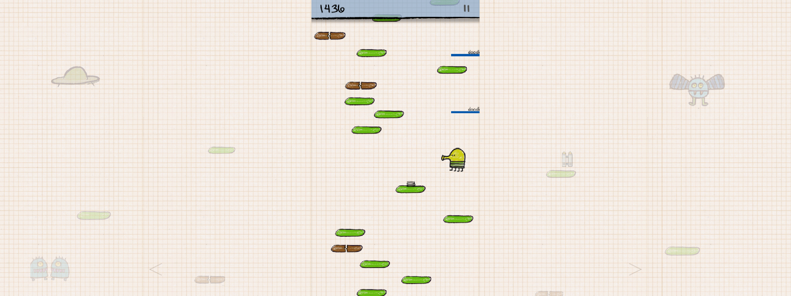

# Doodle Jump for BMW iDrive 7

Play Doodle Jump on iDrive 7 (MGU), with all themes and sounds.

## Install

1. Open **MGU Store** and add this repository:
   ```text
   https://github.com/kxrxh/doodle-jump-mgu
   ```
2. Select **Releases**.
3. Install **Doodle Jump**.

Store installs Python and GPU support automatically. Restart the MGU if Store asks.

To update, refresh the source in Store and install the latest version.

## Controls

Touch controls work without extra tools. iDrive controller support depends on your setup.

Enable **Show FPS** in the game’s main menu to see the drawing mode (GPU or CPU), completed game frames per second, and the frame rate reported by the Store renderer. `--` means a reading is unavailable.


