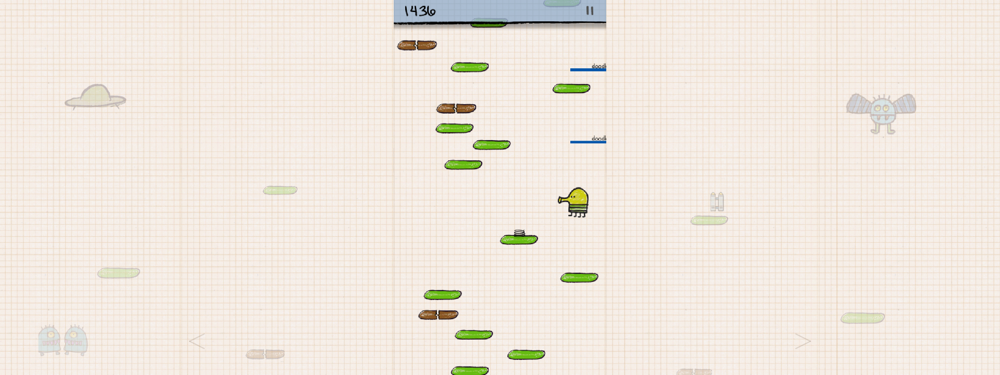

# Doodle Jump for BMW iDrive 7

Play Doodle Jump on iDrive 7 (MGU), with all themes and sounds.

## Install

1. Open **MGU Store** and add this repository:
   ```text
   https://github.com/kxrxh/doodle-jump-mgu
   ```
2. Select **Releases**.
3. Install **Doodle Jump**.

Store installs the required components automatically. Nothing needs to be built on the car.

To update, refresh the source in Store and install the latest version.

## Controls

Touch controls work without extra tools. iDrive controller support depends on your setup.

Experimental: physical head-unit installation, audio and performance are not yet verified.


