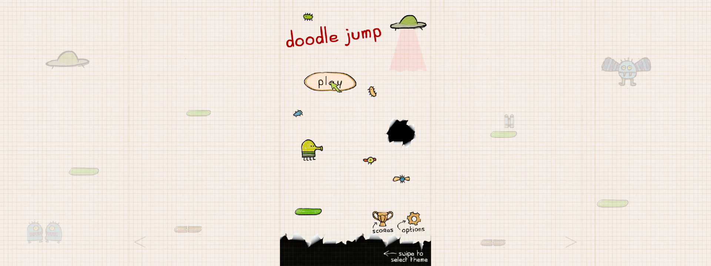

# Doodle Jump for MGU7 WIP

Original Doodle Jump 3.10.0 for BMW iDrive 7. Touch, joystick and rotary ring controls.

About 25 MB to download, about 64 MB of app and extracted runtime files after first launch. Python is shared with mgu-store.

## Install

In mgu-store, add this GitHub source, select **Releases**, and install **Doodle Jump**:

https://github.com/kxrxh/doodle-jump-mgu

The ready package includes the game files and private runtime dependencies. Installation downloads and verifies the package without building the game or downloading an APK on the head unit. It requires mgu-render 0.6.12 and mgu-python 1.0.3 or newer; Store installs requirements first. BMW’s SDK comes from the head unit. The `main` branch is for source builds.

You can also add the catalog URL directly:

https://raw.githubusercontent.com/kxrxh/doodle-jump-mgu/main/catalog.json

The app uses mgu-store's renderer without installing a controller-gate tool. An existing HMI controller gate is reused through the renderer. Without one, touch controls remain available; the HMI retains the iDrive controller, so exclusive ring and joystick control is not guaranteed.

All original themes and sounds are retained. The package uses the original L-resolution images and keeps the host's X font atlas. Its Linux x86-64 Unicorn library includes only ARM emulation for the original ARMv7 game engine.

The C++ backend dispatches engine calls, handles GLES state and vertex preparation, and mixes audio. Graphics calls run directly from Unicorn into C++; Python remains for startup, Android/JNI compatibility, image and sound loading, and communication with the Store interface. The original engine still runs under ARM emulation.

The ready package includes the compiled backend. No C++ compiler is needed on the head unit.

## Local

Run `./run-local.sh` with Python 3.13, Node.js and C/C++ compilers. Open http://localhost:8079.

`python runtime/prepare.py` builds the Linux runtime with Docker against Ubuntu 18.04 / glibc 2.27. It statically links the C++ support libraries and writes `dist/runtime-linux-x86_64.pack`. Private Python dependencies still target Store's Python 3.12. The runtime pin in `tools/runtime.json` must reference the published pack before building a source release.

A local Linux x86-64 Docker check with Store Python 3.12 measured median `Game.step` time of 24.6 ms in 0.3.0 and 18.5 ms in 0.4.0 over three 120-frame batches after warmup. This excludes audio playback, frame transport and Store display; it does not measure physical MGU FPS.

Tested in the original MGU emulator. Physical head-unit installation and audio remain unverified.

## Screenshots

Menu

Gameplay

